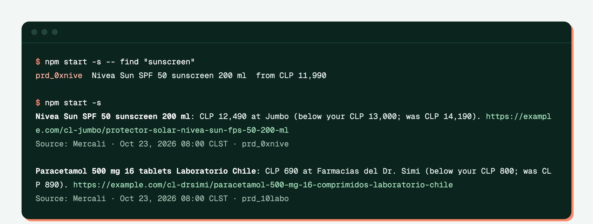

# price-alerts-bot

English · [Español](README.md)

Get notified when a product drops below your price at any Chilean store: on the console, as a push notification through [ntfy](https://ntfy.sh) (no account needed) or through a webhook (Slack, Discord or your own server). It talks to the API over MCP, with the same tools an agent uses, and an agent can set up the alerts for you.



## Try it in a minute

Needs Node 22 or later. No account needed: without `PRICES_API_KEY` it connects to the public sandbox over MCP (`/mcp/sandbox`, no login), which answers with sample data.

```bash
git clone https://github.com/MarceloFarrMintii/price-alerts-bot && cd price-alerts-bot
npm install
npm start                        # checks alerts.json
npm start -- find "sunscreen"    # finds the product_id for an alert
```

## Alerts

`alerts.json` is a list. Each alert says which product to watch and below which price to notify:

```json
[
  { "product": "prd_0xnive", "below": 13000 },
  { "product": "prd_0gnesc", "below": 5500, "retailers": ["cl-jumbo", "cl-unimarc"] }
]
```

| Field | What it is |
|---|---|
| `product` | `product_id` (from `find` or the `search_products` tool) or a barcode |
| `below` | Notify when the price falls below this amount, in local currency (CLP has no decimals) |
| `retailers` | Optional: only these stores |

The bot notifies once, on the day the price crosses the threshold: it compares today's price with the previous day's (`get_prices` with `as_of`), so it keeps no state and doesn't repeat the alert while the price stays low. `npm start -- --all` reports every store under the threshold today, and `--dry-run` shows what it would send without sending anything.

## Where alerts go

| Variable | What it does |
|---|---|
| `NTFY_TOPIC` | Publishes to `ntfy.sh/<topic>`. Install the ntfy app (or open `https://ntfy.sh/<topic>`) and subscribe to the same topic. There is no account: the topic name works as a password, so pick one that is hard to guess. `NTFY_URL` points to your own server if you have one. |
| `WEBHOOK_URL` | Sends a JSON `POST`: `text` and `content` hold the message (the fields Slack and Discord incoming webhooks read) and `alerts` holds the details of each alert. |
| `PRICES_API_KEY` | Your API key. Without it, the sandbox. |
| `PRICES_API_URL` | Another API instance (default `https://mercali-platform.vercel.app`) |
| `LANG` | `es_CL.UTF-8` for messages and product names in Spanish; English otherwise. |

Without `NTFY_TOPIC` or `WEBHOOK_URL`, alerts only go to the console.

## Run it every day

The repo includes [`.github/workflows/alerts.yml`](.github/workflows/alerts.yml): GitHub Actions runs it once a day (13:00 UTC) and on demand from the Actions tab. Under Settings → Secrets and variables → Actions add `NTFY_TOPIC` or `WEBHOOK_URL`, and `PRICES_API_KEY` for real data. To change the alerts, edit `alerts.json` and commit.

## With your agent

The repo includes [`.mcp.json`](.mcp.json) with the sandbox MCP server and [`AGENTS.md`](AGENTS.md) with instructions. Claude Code reads both when you open the repo (it asks you to approve the server the first time); in Cursor or VS Code, add the same URL to their MCP settings. Then ask in your own words:

> Let me know when Nescafé Tradición coffee drops below CLP 5,500 at Jumbo or Unimarc.

The agent finds the product with `search_products`, checks today's price with `get_prices`, tells you which store and when it was observed, and adds the alert to `alerts.json`. For real data, change the URL in `.mcp.json` to `/mcp` and add the header `Authorization: Bearer <your key>`.

## How it works

```
src/mcp.ts      MCP client (official SDK): /mcp/sandbox without a key, /mcp with one; retries 429s
src/check.ts    get_prices today and the day before → stores that crossed the threshold
src/notify.ts   console, ntfy and webhook
src/index.ts    the command line
```

Alerts use `price`, what anyone pays; the store-card price (`card_price`) and multi-buy promotions come separately in the response.

What it costs with a real key: `get_prices` charges 1 credit per store, and the previous-day lookup only runs for products under the threshold today. Repeating the same query within 24 hours is free.

## Tests

The logic is tested with fake tools, and the whole bot against the public sandbox over MCP:

```bash
npm test
npm run typecheck
```

`PRICES_API_URL=http://localhost:8787 npm test` runs them against a local instance.

## License

[MIT](LICENSE).
