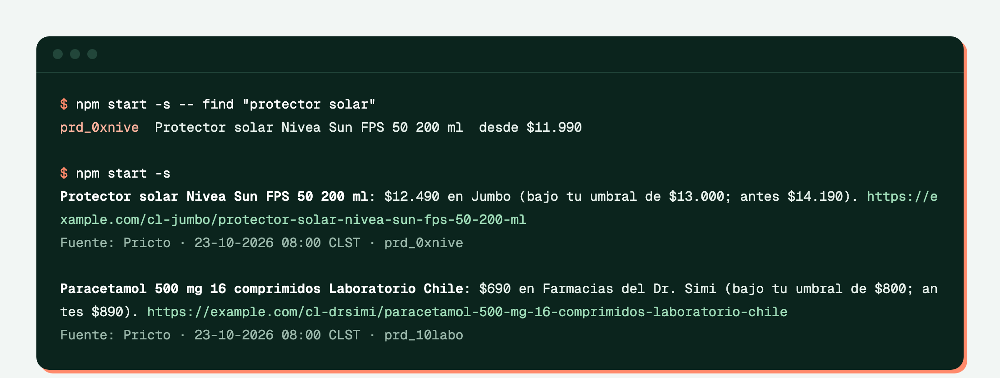

# price-alerts-bot

[English](README.en.md) · Español

Te avisa cuando un producto baja del precio que elegiste en alguna tienda de Chile: por la consola, con una notificación push de [ntfy](https://ntfy.sh) (sin crear cuenta) o con un webhook (Slack, Discord o tu propio servidor). Habla con [Pricto](https://pricto.dev) por MCP, con las mismas tools que usa un agente, y un agente puede configurarle las alertas.



## Pruébalo en un minuto

Requiere Node 22 o superior. No necesitas cuenta: sin `PRICTO_API_KEY` se conecta a la sandbox pública por MCP (`/mcp/sandbox`, sin login), que responde con datos de ejemplo.

```bash
git clone https://github.com/Pricto/price-alerts-bot && cd price-alerts-bot
npm install
npm start                         # revisa alerts.json
npm start -- find "protector solar"   # busca el product_id para una alerta
```

## Las alertas

`alerts.json` es una lista. Cada alerta dice qué producto vigilar y bajo qué precio avisar:

```json
[
  { "product": "prd_0xnive", "below": 13000 },
  { "product": "prd_0gnesc", "below": 5500, "retailers": ["cl-jumbo", "cl-unimarc"] }
]
```

| Campo | Qué es |
|---|---|
| `product` | `product_id` (de `find` o de la tool `search_products`) o código de barras |
| `below` | Avisa cuando el precio queda bajo este monto, en moneda local (CLP sin decimales) |
| `retailers` | Opcional: solo estas tiendas |

El bot avisa una vez, el día en que el precio cruza el umbral: compara el precio de hoy con el del día anterior (`get_prices` con `as_of`), así que no guarda estado y no repite el aviso mientras el precio siga abajo. `npm start -- --all` avisa todas las tiendas que están bajo el umbral hoy, y `--dry-run` muestra lo que avisaría sin mandar nada.

## Dónde llegan los avisos

| Variable | Qué hace |
|---|---|
| `NTFY_TOPIC` | Publica en `ntfy.sh/<tema>`. Instala la app de ntfy (o abre `https://ntfy.sh/<tema>`) y suscríbete al mismo tema. No hay cuenta: el nombre del tema funciona como contraseña, así que elige uno difícil de adivinar. `NTFY_URL` cambia el servidor si tienes uno propio. |
| `WEBHOOK_URL` | Hace `POST` con JSON: `text` y `content` traen el mensaje (los campos que leen los webhooks entrantes de Slack y de Discord) y `alerts`, el detalle de cada aviso. |
| `PRICTO_API_KEY` | Tu API key. Sin ella, la sandbox. |
| `PRICTO_API_URL` | Otra instancia de la API (por omisión `https://pricto.dev`) |
| `LANG` | `es_CL.UTF-8` para mensajes y nombres en español; si no, en inglés. |

Sin `NTFY_TOPIC` ni `WEBHOOK_URL`, el aviso sale solo por la consola.

## Que corra todos los días

El repo trae [`.github/workflows/alerts.yml`](.github/workflows/alerts.yml): GitHub Actions lo corre una vez al día (13:00 UTC) y también a mano desde la pestaña Actions. En Settings → Secrets and variables → Actions agrega `NTFY_TOPIC` o `WEBHOOK_URL`, y `PRICTO_API_KEY` para datos reales. Para cambiar las alertas, edita `alerts.json` y haz commit.

## Con tu agente

El repo trae [`.mcp.json`](.mcp.json) con el servidor MCP de la sandbox y [`AGENTS.md`](AGENTS.md) con las instrucciones. Claude Code lee los dos al abrir el repo (te pide aprobar el servidor la primera vez); en Cursor o VS Code, agrega la misma URL en su configuración de MCP. Después pídeselo en tus palabras:

> Avísame cuando el café Nescafé Tradición baje de $5.500 en Jumbo o en Unimarc.

El agente busca el producto con `search_products`, revisa el precio de hoy con `get_prices`, te dice en qué tienda y a qué hora se observó, y agrega la alerta a `alerts.json`. Para usar datos reales, cambia la URL de `.mcp.json` por `/mcp` y agrega el header `Authorization: Bearer <tu key>`.

## Cómo funciona

```
src/mcp.ts      cliente MCP (SDK oficial): /mcp/sandbox sin key, /mcp con key; reintenta los 429
src/check.ts    get_prices hoy y el día anterior → tiendas que cruzaron el umbral
src/notify.ts   consola, ntfy y webhook
src/index.ts    la línea de comandos
```

El aviso usa `price`, lo que paga cualquier persona; el precio con tarjeta de la tienda (`card_price`) y las promociones por cantidad vienen aparte en la respuesta.

Cuánto cuesta con una key real: `get_prices` cobra 1 crédito por tienda, y la consulta del día anterior se hace solo para los productos que hoy están bajo el umbral. Repetir la misma consulta dentro de 24 horas es gratis.

## Tests

La lógica se prueba con tools falsas y el bot completo, contra la sandbox pública por MCP:

```bash
npm test
npm run typecheck
```

`PRICTO_API_URL=http://localhost:8787 npm test` los corre contra una instancia local.

## Licencia

[MIT](LICENSE).
